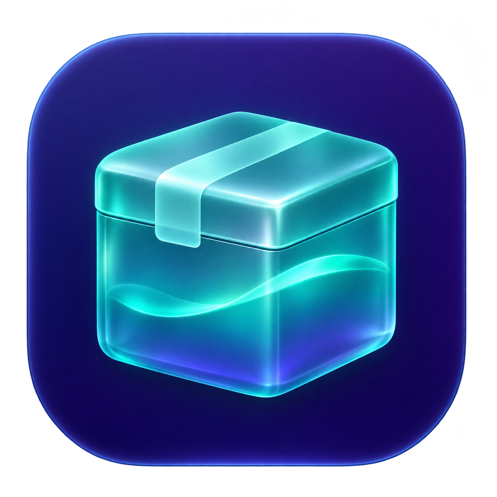

<p align="center">
  
</p>

# LiquidBrew

**A native macOS app for managing Homebrew, discovering useful software, and understanding what is installed on your Mac.**

[](https://github.com/kcdriod/LiquidBrew/actions/workflows/ci.yml)
[](https://github.com/kcdriod/LiquidBrew/actions/workflows/release.yml)
[](LICENSE)

LiquidBrew brings installed packages, charts, updates, background services, dependency graphs, security reports, and a live console into one SwiftUI workspace with a Liquid Glass interface.

**Help build LiquidBrew!** Bug reports, feature ideas, accessibility improvements, documentation, and pull requests are welcome. See [Contributing](CONTRIBUTING.md), [open an issue](https://github.com/kcdriod/LiquidBrew/issues/new/choose), or pick something from the [contribution ideas](#help-wanted).

## Install

Requires **macOS 26 or newer** and an existing [Homebrew](https://brew.sh) installation.

1. Download the universal `.dmg` from [Releases](https://github.com/kcdriod/LiquidBrew/releases/latest).
2. Open the disk image and drag **LiquidBrew.app** into **Applications**.
3. Launch LiquidBrew. It reads your installed packages and Homebrew configuration.

Release DMGs support **Apple Silicon and Intel Macs**. Community builds are ad-hoc signed and are **not Apple-notarized**, so macOS may show a Gatekeeper warning. The app does not bypass macOS security protections.

A `.sha256` file accompanies each DMG. To check a downloaded image, place both files in the same folder and run:

```sh
shasum -a 256 -c LiquidBrew-1.0.0-universal.dmg.sha256
```

Use the filename matching the version you downloaded. You can also [build from source](#build-from-source).

## Features

| Workspace | What you can do |
| --- | --- |
| **Packages** | Browse installed formulae and casks; search by name or description; filter all packages, formulae, casks, top-level packages, pinned packages, or outdated packages. |
| **Package details** | View installed versions, description, homepage, tap, license, install date, caveats, dependencies, build dependencies, and packages that depend on a selection. Pin/unpin formulae, upgrade, or confirm removal. |
| **Discover** | Search as you type, use an explicit Search button, and browse Top Charts or Trending. Switch between formulae and apps, see descriptions and counts, open source details, and install packages. Installed items are marked. |
| **Updates** | Check for outdated packages, update Homebrew's index, upgrade individual packages, or upgrade everything. See installed and current versions and pinned status. |
| **Services** | Inspect Homebrew background services, their status and user; start, stop, or restart them. |
| **Dependency Graph** | Explore formula dependencies in radial or tree layouts. Focus on a selected formula or a network of top-level packages; pan, zoom, select nodes, inspect relationships, and jump to package details. |
| **Taps & Brewfile** | Browse taps, add or remove repositories, preview/regenerate a Brewfile, copy or export it, and import a Brewfile to install its declared packages. |
| **Health & Cleanup** | Run `brew doctor`, read warnings and diagnostic output, inspect cache usage, preview cleanup, clean old versions/cache, and remove unused dependencies. |
| **Security** | Review Homebrew security-related disable/deprecation warnings and recent matching news headlines. Follow source links, see affected installed package names, and confirm removal after checking dependents. Optional Mac notifications alert you to new reports. |
| **Console** | Toggle a resizable panel on the right. Read live command output with distinct command, progress, success, warning, and error styling; search output, filter issues, pause following, jump to latest, wrap lines, show timestamps, copy, or save logs. |

The console records command completion time and exit status and retains the most recent **1,000 lines in the current session**. It is a viewer for commands run by the app, not an interactive shell. Homebrew's own dependency checks remain in effect during removal.

### Top Charts and Trending

Rankings use [Homebrew's published analytics](https://formulae.brew.sh/docs/api/#analytics) and show up to 50 entries per chart:

- **Formula Top Charts:** 30-day download counts for Homebrew's measured subset of formulae, across versions and platforms. These can include repeat downloads and CI. If download data is unavailable, the UI explicitly falls back to reported direct installs.
- **App Top Charts:** reported cask installs over 30 days. These are install events, not comparable download totals or unique users.
- **Trending:** growth in daily reported installs in the latest 30 days against the **preceding 60 days**, calculated by subtracting the recent window from the 90-day totals. Formulae use direct install events, excluding dependencies.
- Trending requires at least 500 recent installs, 100 installs in the prior period, and 10% growth. New packages without a usable baseline are not ranked. Mismatched reporting windows disable the comparison.

The app shows reporting dates, refresh status, source limitations, and saved charts if a refresh fails. Successful chart data is cached in memory for an hour and saved locally for later launches.

### Security reports and notifications

Security checks run at startup, after package refreshes, and every six hours **while LiquidBrew is open**. Enable notifications in **Security**; the app asks macOS for permission when you turn them on.

Sources currently include Homebrew's public formula/cask metadata, the Homebrew news feed, and The Hacker News feed. Source status and the last successful check are visible. A failed source retains previous warnings, which may be out of date.

News matching checks available dated headlines from the last 90 days. It uses package-name boundaries and skips short or ambiguous names. A mention is labeled **review required**: it does not establish that the same product, ecosystem, or installed version is affected. Homebrew metadata warnings cover official taps; removed entries may no longer appear in the current catalogue.

This is a report-review feature, not a malware scanner or a complete vulnerability database. No matches does not guarantee safety. Removing a package does not reverse damage from a compromise; follow the original report's remediation advice.

### Keyboard shortcuts

| Shortcut | Action |
| --- | --- |
| `⌘R` | Refresh Homebrew data |
| `⇧⌘U` | Update Homebrew and taps |
| `⇧⌘G` | Upgrade all outdated packages |
| `⌥⌘T` | Show/hide the right-side console |

## Build from source

Use a **full Xcode installation** with a macOS 26-or-newer SDK and Swift 6 or newer. Command Line Tools alone may lack the SwiftUI compiler plugins required by the selected SDK.

```sh
git clone https://github.com/kcdriod/LiquidBrew.git
cd LiquidBrew
./build_app.sh
open LiquidBrew.app
```

`build_app.sh` selects `/Applications/Xcode.app` when available, builds the app, creates the full Mac icon family from `Assets/AppIcon.png`, writes the bundle metadata, and ad-hoc signs and verifies the result. The default build targets your current Mac architecture.

For a universal release build and DMG:

```sh
BUILD_CONFIGURATION=release BUILD_ARCHS='arm64 x86_64' \
  APP_VERSION=1.0.0 APP_BUILD_NUMBER=1 ./build_app.sh
./scripts/build_dmg.sh 1.0.0
```

The image and SHA-256 checksum are written to `dist/`. The DMG contains the app, an Applications shortcut, and installation notes. Build products and local credentials are excluded from Git.

## Tests

Select your full Xcode toolchain, adjusting the path if necessary:

```sh
export DEVELOPER_DIR=/Applications/Xcode.app/Contents/Developer
swift test --disable-sandbox
```

The default suite tests headline matching, feed parsing, terminal formatting and severity, ranking calculations, search output parsing, visible search errors, and stale-search handling. Tests that depend on public endpoints or a local Homebrew executable are opt-in:

```sh
LIQUIDBREW_DISCOVER_LIVE_TESTS=1 LIQUIDBREW_SECURITY_LIVE_TESTS=1 \
  swift test --disable-sandbox
```

The live Discover test queries Homebrew and public charts; it does not install packages. Local live checks currently exercise 15 tests in total. GitHub pull-request checks run the deterministic tests and verify that the app builds.

## Releases and automation

- **Build and test:** runs on pull requests, pushes to `main`/`master`, and manual dispatches using a macOS 26 GitHub-hosted runner.
- **Release DMG:** pushing a version tag such as `v1.0.0` runs tests, builds an optimized universal app, verifies its signature and architectures, creates and verifies a compressed DMG, and publishes it with its checksum to GitHub Releases.
- Tags such as `v1.1.0-beta.1` become prereleases. The numeric version is embedded in the app; the workflow run number becomes the bundle build number.
- The release workflow also accepts an existing tag through **Actions → Release DMG → Run workflow**. Use a new version tag for a new published release.
- Release artifacts are also retained with the workflow run for 14 days. Publishing uses GitHub's repository-scoped token; no personal access token is required.

Maintainers can publish a version with:

```sh
git tag -a v1.0.0 -m 'LiquidBrew 1.0.0'
git push origin v1.0.0
```

Apple Developer ID signing and notarization are not configured yet. Contributions to that release process are welcome.

## Project structure

```text
Assets/                        App icon artwork and generation prompt
Sources/LiquidBrew/
  LiquidBrewApp.swift           App entry point, navigation, shortcuts, console layout
  DesignSystem/                Shared Liquid Glass styling
  Models/                      Package models and output/search helpers
  Services/                    Homebrew commands, app state, charts, security sources
  Views/                       Packages, Discover, updates, services, graph, maintenance
Tests/LiquidBrewTests/          Deterministic and opt-in live tests
.github/workflows/             Pull-request checks and tagged DMG releases
build_app.sh                   Build, package, icon generation, and ad-hoc signing
scripts/build_dmg.sh            Universal DMG creation and checksum
```

Package commands run locally through the Homebrew executable. Installed inventory is not uploaded to a project-owned server. Discover and Security fetch public registry, analytics, and news data; Homebrew's own analytics settings are separate from LiquidBrew.

## Help wanted

There is plenty of room to improve LiquidBrew. Useful contributions include:

- Accessibility, keyboard navigation, VoiceOver, and small-window layouts.
- Better search ranking, pagination, and discovery filters.
- Additional reliable security sources and version-aware advisory matching.
- Graph performance and clearer dependency explanations for large installations.
- Testing across Apple Silicon and Intel Macs and different Homebrew installations.
- Developer ID signing, notarization, and distribution improvements.
- Documentation, screenshots, translations, and reproducible bug reports.

Start with [CONTRIBUTING.md](CONTRIBUTING.md). For a larger change, open an issue first so we can agree on the behavior and avoid duplicate work. Small fixes and documentation improvements are welcome directly as pull requests.

## License and acknowledgements

[MIT License](LICENSE). LiquidBrew is an independent project and is not affiliated with Homebrew or Apple.

Built with SwiftUI and [Homebrew](https://brew.sh). Discovery data comes from [Homebrew Formulae](https://formulae.brew.sh); security headlines link back to their original publishers. The app icon was created with OpenAI's image generator; its design prompt is included in `Assets/AppIcon.prompt.txt`.
